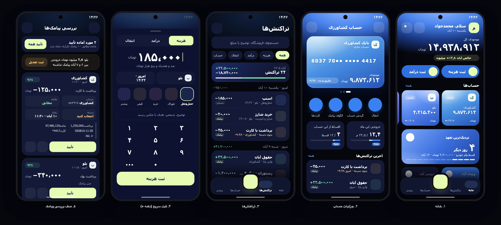
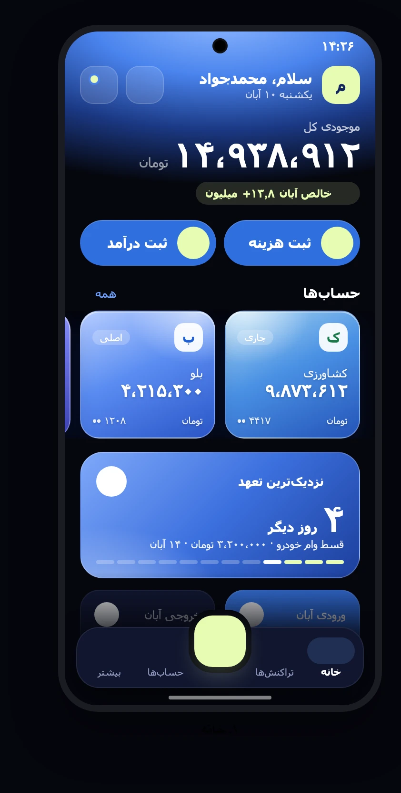
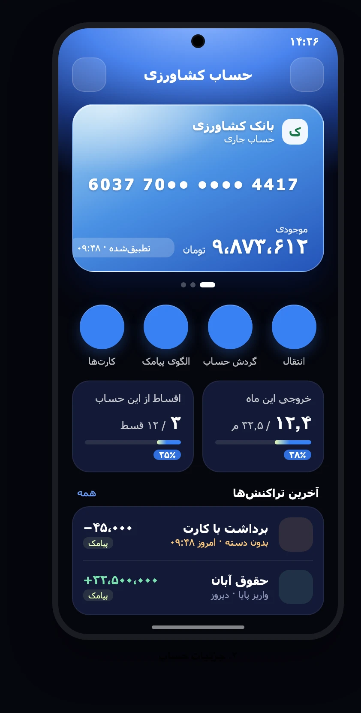
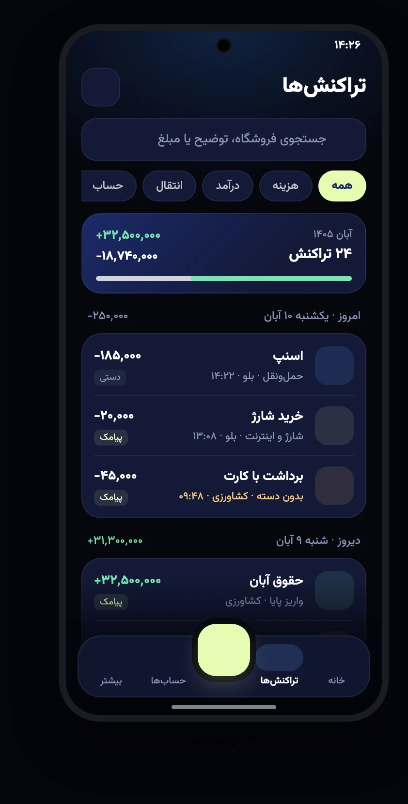
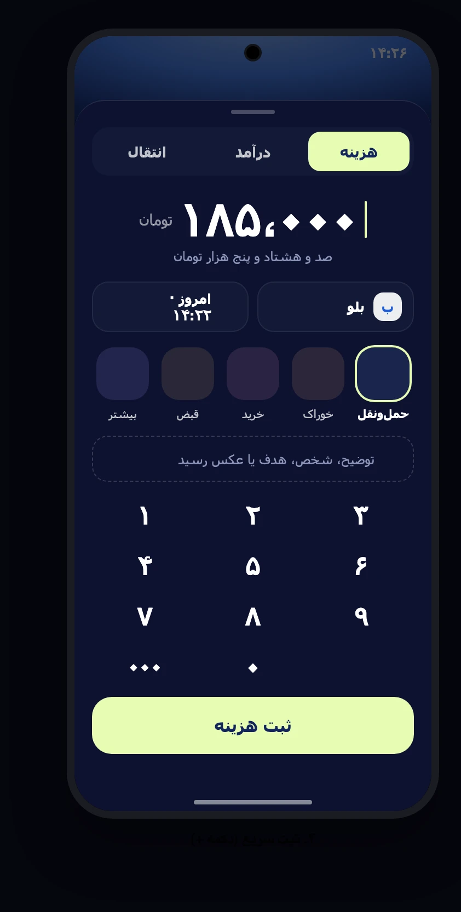
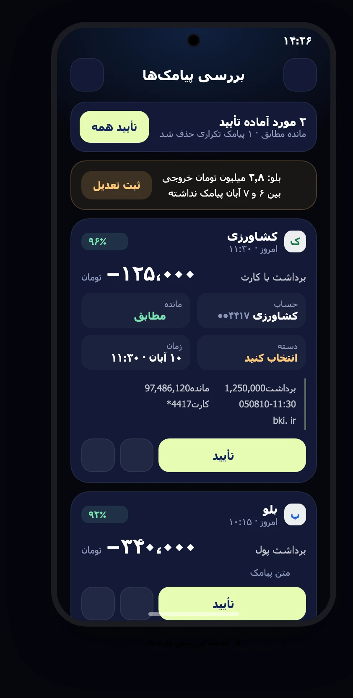
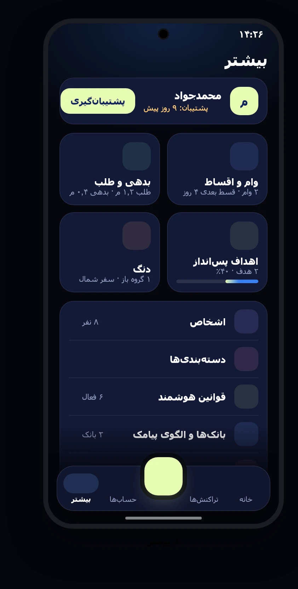

<div align="center">


# جیب‌من · Jibeman

### مدیریت مالی، دخل‌وخرج، اقساط، دنگ و پیامک بانکی — روی دستگاه خودت
**Offline-first Persian personal finance, expense tracker, SMS parser & budget manager for Android and Web · your money, your data, your device**

[](docs/INSTALL.md)
[](docs/INSTALL.md)
[](#privacy)
[](#privacy)
[](#english)
[](#dev)
[](#dev)
[](#privacy)

[**نصب**](docs/INSTALL.md) · [**امکانات**](#features) · [**تصاویر**](#screenshots) · [**امنیت و حریم خصوصی**](#privacy) · [**توسعه‌دهندگان**](#dev) · [**English**](#english) · [**دانلود APK**](https://github.com/javadSharifi/jibeman/releases)

<a href="#screenshots"></a>

</div>

<div dir="rtl">

## جیب‌من چیست؟

**جیب‌من** یک ابزار هوشمند، امن و همه‌جانبه برای **مدیریت مالی شخصی، حسابداری روزمره، پیگیری اقساط و پیامک‌های بانکی** است که با تمرکز ویژه بر نیازهای کاربران ایرانی، تقویم جلالی (شمسی) و واحد‌های پولی تومان و ریال طراحی شده است. 

این برنامه در دو نسخه عرضه می‌شود:
1. **اپلیکیشن نیتیو اندروید (Android Native):** نوشته‌شده با Kotlin و Jetpack Compose، با کمترین مصرف رم و باتری، و **کاملاً آفلاین** (بدون حتی درخواست مجوز اینترنت در مانیفست اندروید!).
2. **وب‌اپلیکیشن پیش‌رونده (PWA):** قابل نصب روی آیفون (iOS)، آیپد، ویندوز، مک و لینوکس با موتور ذخیره‌سازی محلی IndexedDB و رمزنگاری پیشرفته.

جیب‌من برای کسانی ساخته شده که می‌خواهند بدانند **«پول‌هایشان کجا رفته است؟»**، چه اقساطی در راه دارند، از چه کسانی طلبکارند یا بدهی دارند، و در خریدهای روزمره جلوی هزینه‌های هیجانی و بی‌مورد را بگیرند — بدون اینکه نگران فاش شدن اطلاعات حساب یا پیامک‌های بانکی خود باشند.

> **تمام داده‌های مالی روی گوشی و حافظهٔ محلی دستگاه خودتان باقی می‌مانند.** بدون نیاز به حساب کاربری، بدون تبلیغات آزاردهنده، بدون هیچ‌گونه ردیاب آماری، و بدون اتصال اجباری به اینترنت. همگام‌سازی ابری کاملاً اختیاری، تحت کنترل خودتان و با رمزنگاری مبدأ تا مقصد (Zero-Knowledge) است.

<a id="features"></a>

## ✨ امکانات

### 💳 حساب‌ها، کارت‌ها و موجودی بانک‌ها
- **مدیریت کارت‌های بانکی با تم واقعی:** تفکیک و پشتیبانی از بیش از **۲۸ بانک ایرانی** (ملی، ملت، صادرات، تجارت، سپه، بلو، پاسارگاد، سامان، رسالت، کشاورزی، پارسیان و...) با رنگ‌های اختصاصی، گرادیانت زیبا و نماد بانک.
- **اطلاعات کارت و شناسه‌ها:** نگهداری امن ۴ رقم آخر، شماره شبا، تاریخ انقضا (ماه و سال با اعتبارسنجی خودکار) و CVV2 برای پرداخت‌های اینترنتی روزمره.
- **تفکیک حساب‌ها:** دسته‌بندی حساب‌ها در قالب کارت بانکی، حساب پس‌انداز، پول نقد، حساب ارزی یا کیف‌پول.
- **ورودی هوشمند مبالغ:** پذیرش ارقام به فارسی، عربی و انگلیسی، جداکنندهٔ سه‌رقمی در لحظه تایپ، و درج معادل **حروفی فارسی مبلغ** زیر ورودی (مثلاً: «صد و بیست و پنج هزار تومان»).

### 📩 پردازش هوشمند پیامک‌های بانکی (SMS Parser)
- **ثبت خودکار تراکنش‌ها بدون اینترنت:** خواندن مستقیم پیامک‌های تراکنش واریز، برداشت، خرید و انتقال کارت‌به‌کارت بر روی گوشی اندروید.
- **الگوهای فیلدی مقاوم:** پردازش خط‌به‌خط ساختار پیامک‌های بانکی با قالب‌های فیلدی منعطف، حتی در صورت جابه‌جایی خطوط توسط سیستم پیامک بانک.
- **تشخیص هوشمند تکرار:** جلوگیری کامل از ثبت دوگانهٔ یک تراکنش در صورت دریافت چندبارهٔ پیامک.
- **صف بررسی تراکنش‌ها:** امکان بازبینی، تایید یا ویرایش تراکنش‌های استخراج‌شده قبل از نهایی شدن.

### 💸 تراکنش‌ها، دسته‌بندی و موتور قوانین
- **ثبت سریع با یک کلیک:** دکمهٔ برجستهٔ `+` در مرکز برنامه برای ثبت آنی هزینه، درآمد یا انتقال بین حساب‌ها در کمتر از ۵ ثانیه.
- **دسته‌بندی‌های منعطف:** دسته‌های پیش‌فرض کاربردی (خوراک، مسکن، حمل‌ونقل، سلامت، تفریح، آموزش و...) با قابلیت تعریف آیکون، رنگ و دسته‌بندی‌های دلخواه نامحدود.
- **موتور قوانین شرطی (Smart Rules Engine):** برچسب‌گذاری و دسته‌بندی خودکار تراکنش‌ها بر اساس کلمات کلیدی، متن پیامک یا نام فروشگاه و پذیرنده.

### 🏦 مدیریت وام‌ها و اقساط
- **وام‌های فعال و در حال بازپرداخت:** ثبت وام جدید یا ثبت سریع وام‌های از قبل فعال همراه با مشخص کردن تعداد اقساط پرداخت‌شده قبلی بدون برهم‌زدن تاریخچه تراکنش‌ها.
- **جدول زمان‌بندی اقساط:** محاسبه تاریخ سررسید تک‌تک اقساط، مانده کل بدهی، تعداد اقساط پرداخت‌شده و اقساط معوقه.
- **اتصال حساب پرداخت قسط:** تعیین حساب پیش‌فرض برای کسر قسط، با امکان تغییر سریع حساب در پنجره تأیید پرداخت.
- **پیشگیری از جریمه دیرکرد:** یادآوری موعد پرداخت اقساط و نمایش در باکس تعهدات ماه جاری.

### 🤝 طلب، بدهی و تعهدات اشخاص
- **دفترچه بستانکاری و بدهکاری:** ثبت مبالغی که به دیگران قرض داده‌اید یا از آن‌ها قرض گرفته‌اید به تفکیک اشخاص.
- **تسویه مرحله‌ای:** ثبت پرداخت‌ها و دریافت‌های خرد و محاسبه خودکار مانده‌حساب با هر فرد.
- **تاریخ سررسید و یادآور:** جلوگیری از فراموشی موعد بازپس‌گیری یا بازپرداخت وجوه.

### 👥 دنگ و تسویه حساب گروهی (Split Wise)
- **مدیریت هزینه‌های سفر و دورهمی:** ایجاد گروه‌های سفر، مهمانی، کافه یا اجاره خانه مشترک.
- **محاسبه هوشمند سهم:** پشتیبانی از تقسیم مساوی، سهم‌های نابرابر یا هزینه‌های اختصاصی.
- **ساده‌سازی تسویه (Debt Simplification):** محاسبه ماتریس بدهی‌ها و پیشنهاد تراکنش‌ها با **حداقل تعداد جابه‌جایی پول** بین افراد.

### 🎯 اهداف پس‌انداز و تعهدات ماهانه
- **تعریف صندوق‌های هدف:** تعیین اهداف پس‌انداز (خرید خودرو، لپ‌تاپ، صندوق اضطراری، سفر) با مبلغ هدف و تاریخ موعد.
- **نوار پیشرفت بصری:** مشاهده درصد تحقق هدف با هر واریز جدید.
- **تعهدات ماهانه:** ثبت حداقل پس‌انداز برنامه‌ریزی‌شده برای هر ماه و سنجش میزان پایبندی.

### 🧠 دستیار خرید عقلانی و ترمز خرید هیجانی (Impulse Brake)
- **سیستم مهار خریدهای هیجانی:** توقف هوشمند قبل از خریدهای وسوسه‌انگیز با ایجاد دورهٔ تأمل (Cooling Period) و پرسش‌های سقراطی برای تفکیک «نیاز واقعی» از «خواسته گذرا».
- **ماتریس مقایسه کالا (Shopping Compare):** مقایسه رو‌در‌روی چند گزینه خرید با وزن‌دهی به معیارهای مختلف (قیمت، کیفیت، دوام، امکانات) برای انتخاب بهترین گزینه.
- **نگهبان معامله (Deal Guard & Cheap Trap):** شناسایی تخفیف‌های ساختگی و تله‌های ارزان‌قیمت بی‌کیفیت.

### 📊 داشبورد تحلیلی و گزارش‌های ماهانه شمسی
- **باکس تعهدات این ماه:** مشاهده مجموع اقساط، چک‌ها و بدهی‌های سررسیدشده در ماه جاری به‌صورت یک‌جا در بالای داشبورد.
- **نمودار و توزیع هزینه‌ها:** نمایش سهم هر دسته‌بندی از کل مخارج در ماه و مقایسه دخل‌وخرج.
- **تقویم و گزارش‌های تمام‌شمسی:** دسته‌بندی دقیق ماه‌های فروردین تا اسفند با در نظر گرفتن سال‌های کبیسه.

<a id="screenshots"></a>

## 📱 تصاویر برنامه

<table width="100%">
  <tr>
    <td align="center" width="33%"><br /><sub><b>داشبورد و خانه</b><br />موجودی کل، تعهدات و حساب‌ها</sub></td>
    <td align="center" width="33%"><br /><sub><b>جزئیات حساب</b><br />کارت بانکی، موجودی و اقساط</sub></td>
    <td align="center" width="33%"><br /><sub><b>تراکنش‌ها</b><br />جستجو، فیلتر و خلاصه ماه</sub></td>
  </tr>
  <tr>
    <td align="center" width="33%"><br /><sub><b>ثبت سریع (+)</b><br />ورودی هوشمند و معادل حروفی</sub></td>
    <td align="center" width="33%"><br /><sub><b>پردازش پیامک بانکی</b><br />استخراج فیلدها و تأیید تراکنش</sub></td>
    <td align="center" width="33%"><br /><sub><b>امکانات بیشتر</b><br />وام، دنگ، اهداف و قوانین</sub></td>
  </tr>
</table>

<a id="privacy"></a>

## 🔒 حریم خصوصی و امنیت داده‌ها

جیب‌من بر اساس اصل **احترام کامل به حریم شخصی کاربر** بنا شده است:

1. **کاملاً آفلاین در اندروید (Zero Network Permission):** در فایل `AndroidManifest.xml` هیچ مجوزی برای دسترسی به شبکه و اینترنت (`INTERNET`) وجود ندارد. این بدان معناست که سیستم‌عامل اندروید از نظر ساختاری اجازهٔ ارسال حتی ۱ بیت از اطلاعات یا پیامک‌های شما به بیرون از دستگاه را نمی‌دهد.
2. **پایگاه داده رمزنگاری‌شده (Encrypted at Rest):**
   - در اندروید: استفاده از **Room + SQLCipher** به همراه کلیدهای سخت‌افزاری **Android Keystore**.
   - در وب / PWA: رمزنگاری ردیف‌های حساس پایگاه داده IndexedDB با الگوریتم **AES-GCM** و کلید محلی مشتق‌شده با PBKDF2.
3. **محافظت از کارت‌های بانکی:** اطلاعات حساسی مانند شماره کارت، CVV2، شبا و مشخصات مخاطبان مالی در لایه ذخیره‌سازی رمزنگاری می‌شوند و هرگز به‌صورت متن خام ذخیره یا ارسال نمی‌شوند.
4. **قفل بیومتریک و پین:** ورود امن با سنسور اثر انگشت یا کد پین شخصی؛ برنامه در زمان خروج یا تغییر به برنامه‌های دیگر به‌صورت خودکار قفل می‌شود.
5. **پشتیبان‌گیری محلی و مستقل:** تهیه خروجی فایل JSON و پشتیبان رمزدار با رمز عبور دلخواه که به هیچ سروری وابسته نیست.
6. **همگام‌سازی ابری با معماری صفر-دانش (Zero-Knowledge):** در صورت تمایل به استفاده از همگام‌سازی اختیاری، داده‌ها قبل از خروج از دستگاه رمزنگاری می‌شوند و سرور D1 تنها رشته‌های رمزگذاری‌شده بدون کلید را میزبانی می‌کند.

---

## ❓ پرسش‌های متداول (FAQ)

**آیا پیامک‌های بانکی من به جایی ارسال می‌شوند؟**  
خیر. در نسخه اندروید اصلاً مجوز اینترنت وجود ندارد و عملیات خواندن و پردازش پیامک‌ها ۱۰۰٪ داخل پردازنده گوشی شما انجام می‌شود.

**آیا می‌توانم از جیب‌من روی آیفون (iOS) یا کامپیوتر استفاده کنم؟**  
بله! نسخهٔ وب یک PWA کامل است. کافی است آدرس برنامه را در سافاری آیفون باز کرده و گزینه «Add to Home Screen» را بزنید. روی رایانه نیز از طریق Chrome یا Edge قابل نصب در پنجرهٔ مستقل است.

**آیا داده‌های من با تعویض گوشی پاک می‌شوند؟**  
اگر قبل از تعویض گوشی از بخش «پشتیبان‌گیری» یک فایل خروجی بگیرید، می‌توانید آن را به سادگی روی گوشی جدید بازیابی کنید. همچنین با فعال‌سازی همگام‌سازی اختیاری، داده‌ها بین دستگاه‌ها همگام خواهند بود.

**واحد مبالغ در برنامه چیست؟**  
برای جلوگیری از خطاهای محاسباتی اعشاری، داده‌ها در دیتابیس با دقت بالا به ریال ذخیره می‌شوند اما در تمامی صفحات و فرم‌ها به **تومان** نمایش داده شده و محاسبه می‌گردند.

---

<a id="dev"></a>

## 🛠️ برای توسعه‌دهندگان

### پشتهٔ فنی (Tech Stack)

- **هستهٔ اندروید نیتیو:** Kotlin · Jetpack Compose (Material 3) · Room · SQLCipher · AndroidX Biometrics · BouncyCastle · Gradle (Kotlin DSL)
- **هستهٔ وب و PWA:** React 18 · TypeScript (Strict) · Vite 6 · Tailwind CSS · Dexie (IndexedDB) · Web Crypto API (AES-GCM) · Lucide Icons
- **بک‌اند همگام‌سازی اختیاری:** Cloudflare Workers · Cloudflare D1 (Serverless SQLite) · Wrangler

### اجرای محیط توسعه وب
```bash
npm install          # نصب وابستگی‌ها
npm run dev          # اجرای سرور توسعه Vite (پیش‌فرض: http://localhost:5173)
npm run build        # بیلد production نسخه وب
npm run preview      # پیش‌نمایش خروجی بیلد
```

### اجرای بیلد اندروید
```bash
./gradlew test                  # اجرای تست‌های واحد JVM
./gradlew assembleDebug         # ساخت APK دیباگ
./gradlew assembleRelease       # ساخت APK نهایی و بهینه‌سازی‌شده با ProGuard/R8
```

<details>
<summary><b>همگام‌سازی ابری اختصاصی (Cloudflare Worker + D1)</b></summary>

```bash
pnpm exec wrangler login
pnpm exec wrangler d1 create jibeman-db                # شناسه database_id را در wrangler.jsonc قرار دهید
pnpm exec wrangler d1 migrations apply jibeman-db --remote
pnpm exec wrangler deploy
```

آدرس سرویس را در متغیر محیطی کلاینت قرار دهید:
`VITE_SYNC_URL=https://jibeman-sync.<your-subdomain>.workers.dev`
جزئیات در [docs/SYNC.md](docs/SYNC.md).
</details>

<details>
<summary><b>فرآیند انتشار نسخه (CI / GitHub Actions)</b></summary>

با ایجاد تگ نسخهٔ جدید (مانند `v0.2.1`) یا اجرای دستی گردش‌کار «Build & Release Android APK» در گیت‌هاب، فایل APK امضاشده به‌صورت خودکار توسط GitHub Actions تولید شده و در صفحهٔ Releases بارگذاری می‌شود.

متغیرهای زیر در GitHub Secrets مخزن مورد استفاده قرار می‌گیرند:
- `KEYSTORE_BASE64` (محتوای Base64 کلید امضا)
- `KEYSTORE_PASSWORD`، `KEY_ALIAS`، `KEY_PASSWORD`

توضیحات تکمیلی در [docs/KEYSTORE.md](docs/KEYSTORE.md).
</details>

### مستندات تکمیلی
[راهنمای نصب](docs/INSTALL.md) · [همگام‌سازی و رمزنگاری](docs/SYNC.md) · [کلید امضا](docs/KEYSTORE.md) · [ساختار محصول و فازها](docs/STRUCTURE.md) · [قالب پیامک بانک‌ها](docs/BANK-FORMATS.md) · [سیستم طراحی](docs/DESIGN-SYSTEM.md)

</div>

---

<a id="english"></a>

## English

**Jibeman (جیب‌من, “my pocket”)** is an **offline-first personal finance manager, expense tracker, installment tracker, and Persian SMS parser** built for Android and modern web browsers (PWA). It empowers you to track accounts, cards, debts, shared trip expenses (split bills), savings goals, and bank SMS notifications — **with zero tracking, no advertisements, and total data privacy**.

### Highlights

- **Accounts & Bank Cards:** Support for 28+ Iranian banks with authentic card palettes, cardholder info, IBAN, CVV2, expiry dates, and balance calculation.
- **Smart SMS Parsing (Android):** Instant offline parsing of bank transaction SMS (deposits, withdrawals, transfers) with regex template engines and duplicate-detection.
- **Transactions & Custom Rules:** Instant manual entry via quick floating button, unlimited categories, and a rule engine to automatically tag and classify transactions.
- **Loans & Installments:** Full installment scheduling, payment reminders, tracking paid vs overdue installments, and auto-linking default repayment accounts.
- **Debts & Receivables:** Track money owed and lent with partial settlements and contact logs.
- **Split Wise / Group Expenses:** Easily balance group trips, parties, and room expenses with minimized debt settlement transactions.
- **Rational Shopping & Impulse Brake:** Thoughtful cooling-off timer, Socratic assessment questions for emotional purchases, product comparison matrices, and deal-guard analysis.
- **Jalali / Persian Calendar & Numbers:** Native Persian/Arabic numeral input sanitization, three-digit currency delimiters, and word-by-word Persian verbal equivalents in Tomans and Rials.
- **Private by Design:**
  - **Android:** Fully offline with **no `android.permission.INTERNET`** requested. SMS and financial logs never leave the device.
  - **Encrypted Storage:** Room + SQLCipher on Android; AES-GCM encrypted IndexedDB in Web/PWA.
  - **Biometrics & PIN:** Fingerprint and PIN lock on launch and app resume.
  - **Cloud Sync:** Optional zero-knowledge end-to-end encrypted synchronization via Cloudflare Workers and D1 database.

### Installation
- **Android:** Download the latest `jibeman-vX.Y.Z.apk` from [GitHub Releases](https://github.com/javadSharifi/jibeman/releases) (Android 7.0+). See [docs/INSTALL.md](docs/INSTALL.md) for details.
- **Web / iOS / Desktop:** Open the web app in Safari or Chrome, tap Share/Menu and select "Add to Home Screen" or "Install App".

### Build & Development
- **Web:** `npm install && npm run dev` (Node 20+, Vite, React 18, TypeScript, Dexie).
- **Android:** `./gradlew assembleDebug` or `./gradlew assembleRelease` (JDK 17, Android SDK 36, Jetpack Compose).

<sub>Keywords: personal finance, expense tracker, money manager, SMS parser, Iranian bank SMS, offline-first, Android app, PWA, Jalali calendar, Shamsi, Persian, RTL, Toman, Rial, installment tracker, loan manager, split bills, debt manager, impulse buying brake, SQLCipher, Jetpack Compose, React, Dexie, Cloudflare Workers, Zero Knowledge.</sub>
